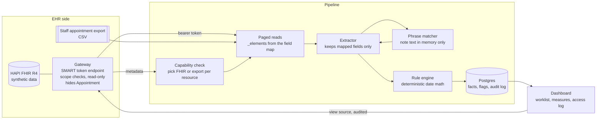

# fhir-followup-recall-pipeline

A read-only pipeline that pulls chart data from an EHR's FHIR R4 API, finds patients who are overdue for follow-up care using rules the clinical team signs, and gives the call center a prioritized worklist where every row cites the chart facts that put it there. It is built around a pain management and physical therapy practice: injections, shockwave and magnetic therapy series, provider-requested return visits, missed visits, and lapsed care.

This is a working demo on synthetic data. A stock HAPI FHIR server stands in for the EHR's FHIR API, behind a small gateway that behaves like an EHR's front door where it matters: SMART backend-services tokens, per-resource scopes, read-only access, and a resource the tenant doesn't expose. Every patient, provider, phone number (555-01xx), address and plan name is made up. The intervals, code lists and phrases in `config/rules.yaml` are placeholders that exercise the pipeline, not clinical guidance.

## Quick start

```bash
docker compose up --build
```

Open http://localhost:8080 and click **Start a run**. The first start takes a minute or two while HAPI boots and the seed job loads about 7,700 synthetic resources for 240 patients. A run reads everything through the gateway, evaluates the rules and fills the dashboard, which takes about 10 seconds.

```bash
docker compose exec app python -m recall verify-demo   # run once and check the scripted patients
docker compose down -v                                  # stop and discard all data
```

## What the dashboard shows

| Page | What it is for |
|---|---|
| Overview | The latest run: patients read, flagged, held back, dropped. Where each resource came from (FHIR or the staff export), the token's scopes and lifetime, and the run history with the rule-sheet hash each run used. |
| Worklist | One row per patient, by priority and days overdue, split by provider. Each row shows the leading reason, any other reasons, the source records behind it, and SMS or call depending on consent. Downloadable as a CSV queue. |
| Patient | The four measures (shockwave sessions, magnetic therapy sessions, last visit, injections in the last 12 months), every source record behind each one, any record that looked like a session but wasn't counted (and why), why the patient is flagged, held back or dropped, an outreach-outcome form, and that patient's access log. |
| Patient measures | The four measures for every patient, as a table and a CSV, with a "not counted" tag where a record was seen but set aside. |
| Rule sheet | The current rules in plain language, what counts as each treatment, the return-visit phrases, the suppressions, and the field map. Warns when the file has changed since the last run. |
| Access log | Every read of patient data, by whom and when, including each source record opened from the dashboard. |
| Pilot report | Flagged, held back, dropped, and outreach outcomes (reached, booked, declined, no answer, do-not-contact). |

Clicking any source reference (`Procedure/proc-000004`, `DocumentReference/doc-000005`, an export row) fetches that record live through the gateway with a fresh token and writes a `source_viewed` row to the access log. For notes, the text is shown so staff can check the match. It is not stored.

## Architecture



Five containers come up: `fhir` (HAPI, not published to the host), `gateway` (port 8081), `seed` (loads the data, writes the export, exits), `db` (Postgres), and `app` (pipeline and dashboard, port 8080).

## How a run works

1. **Capability check.** The run reads the server's CapabilityStatement and decides, resource by resource, whether to read it over FHIR or fall back to the staff export. The gateway hides `Appointment` by default to simulate a tenant that doesn't expose scheduling over its FHIR API, so appointments come from `appointments.csv`. Set `HIDDEN_RESOURCES=` and the same run reads them over FHIR with no rule change.
2. **Token.** The client signs a JWT assertion with its private key (RS384) and exchanges it for a 5-minute access token at the gateway's token endpoint. It asks only for `system/<Type>.read` scopes for the resources it will actually read. The gateway checks the signature, audience, expiry and a one-time `jti`, and issues only the scopes that client is allowed.
3. **Reads.** Searches are paged, and each one sends `_elements` from `config/fieldmap.yaml`, so date of birth, address, email and the rest never leave the server. Next-page links point back at the gateway, so every page is token-checked too.
4. **Extraction.** Each resource becomes zero or more *facts*: a dated, sourced statement such as "injection 20610 on Aug 30, from `Procedure/proc-000004`". A Procedure, MedicationAdministration or Condition with a code that isn't on the rule sheet produces nothing. Notes are decoded in memory, matched against the signed phrase list, and discarded. Only the phrase id, the date and the note's resource id are kept.
5. **Measures.** Treatment sessions are counted as distinct days. An injection charted as a Procedure and again as a MedicationAdministration, and described in the note, counts once with all three sources listed. A session that appears only in a note still counts, and it is labelled as note-only.
6. **Rules.** Plain date arithmetic over facts, from `config/rules.yaml`. A patient who meets several rules gets one row: the lowest priority number leads and the others are listed.
7. **Suppression.** Deceased, do-not-contact on the chart, do-not-contact logged by staff, discharged, or a visit already booked: the patient is held back and the reason is recorded.
8. **Evidence or nothing.** A flag must cite at least one dated fact with a source reference. A rule that fires without one, for example "no visit in 90 days" for a patient with no visit on record, is dropped and counted rather than put in front of the call center.
9. **Persist and audit.** Each run is a snapshot that records the rule sheet's version and SHA-256, the matcher, the coverage and the token. Every patient read gets an access-log row per resource type. Detail for runs older than `RETAIN_RUNS` is pruned. Run summaries, outreach outcomes and the access log are kept.

## The four measures

The practice-level question "for each patient, how many shockwave and magnet sessions, when was the last visit, how many injections in the last 12 months and when was the last one" is answered like this:

| Measure | Source | Notes |
|---|---|---|
| Shockwave sessions | `Procedure` with a code from `modalities.shockwave.procedure_codes` (CPT 0101T or a practice code), plus notes matching the shockwave phrases | Distinct days. Negated ("declined shockwave session") and planned ("plan: shockwave session next visit") mentions don't count. |
| Magnetic therapy sessions | `Procedure` with a practice code (magnetic therapy has no standard CPT code), plus note phrases | Distinct days. |
| Last visit | Latest `Encounter` with status `finished` | Booked or cancelled appointments are not visits. |
| Injections in the last 12 months, and the last one | `Procedure` with an injection CPT code (20610, 20611, 20552, 20553, 64483, 62323), `MedicationAdministration` of a listed drug by a listed route, and note phrases | A flu shot given IM is not on the drug list, so it isn't counted. The window is `lookback_days`. |

A record that looks like a session but doesn't meet the rule sheet is kept as a "not counted" near miss and listed on the patient page with the reason: a negated or planned note phrase (with the word that blocked it), or a drug outside the list given by a listed route. Only the reason and the source reference are stored, not the note text or the drug name, so opening the source is how staff see the record itself. A near miss on a day that already counts isn't shown, because it doesn't change the count.

How reliable the counts are depends on how consistently the practice codes these treatments. When they're coded, the counts come straight from the coded records. When some live only in free text, the phrase list fills the gap and the dashboard shows which sessions came from notes, so the clinical team can see how much the count leans on them.

## Design decisions

- **Rules are code-free and versioned.** The rule sheet is a YAML file the clinical lead can read and sign. Every run stores its hash, and the dashboard warns when the file has changed since the last run, so any flag can be traced to the exact rules that produced it.
- **The model never decides who gets called.** Interval math, code matching, suppression and priority are deterministic. The only place a model can be used is phrase matching, and there it picks ids from a closed catalog using a JSON schema with an `enum`. It can recognize "see her back in about a month" as the 4-week return phrase. It can't invent a rule, a date or a sentence.
- **Failures fail closed.** A refusal, a truncated answer, an unreadable answer or an API error counts as "no match" and increments `matcher_errors` on the run. It never counts as a match. The matcher doesn't retry on a different model: which model read the note is part of the audit trail and of the BAA scope, so swapping it silently is the wrong default here.
- **Minimum necessary is enforced three times.** The token's scopes come from the field map, the server is asked for mapped `_elements` only, and the extractor reads only the fields it needs. A test fails if a patient-level table gains a column that isn't in the field map, and another checks that note text, birth dates and addresses never reach the database.
- **Nothing is written to the chart.** The gateway rejects anything but GET. Outreach outcomes go to the outreach log, and a staff-logged do-not-contact keeps the patient off future worklists without touching the record.
- **The export path is a first-class source, not a hack.** Scheduling data often sits behind a different door than the clinical chart. The export reader takes only the mapped columns (an export usually carries DOB, address and insurance as well) and maps the report's status words to FHIR appointment statuses. Rows with an unmapped status are counted, not guessed.

## Using a model for phrase matching (optional)

The default matcher (`MATCHER=phrase-list`) is deterministic and runs offline. It normalizes clinical shorthand (RTC, f/u, wk/wks, mo/mos, number words) and skips negated or planned mentions within the same sentence, reporting skipped session phrases as "not counted" with the word that blocked them.

`MATCHER=claude` sends each note to the Anthropic API (`LLM_MODEL`, default `claude-opus-5-5`) with the catalog and a strict JSON schema. Only point it at an endpoint covered by a BAA, and never at real patient data in this demo. Only the first-party client is wired here. Running it through another BAA-covered host, such as Amazon Bedrock, means swapping the client, which this demo doesn't do. The model matcher reports only what a note documents, so with it the "not counted" list holds medication near misses only. The tests use a stub client, so live model calls are not exercised in the test suite or in CI.

## Scripted patients

The first thirteen patients are scripted, and `verify-demo` (and the test suite) check that each comes out as described. The other 227 are generated from a fixed seed.

| Id | Name | What it shows |
|---|---|---|
| p-0001 | Marisol Quintero | 3 injection days in 12 months. The last is charted as a Procedure and a MedicationAdministration and counted once. Post-injection follow-up overdue. SMS. |
| p-0002 | Desmond Achterberg | 2 of 4 shockwave sessions, series stalled. No SMS consent, so a call task. |
| p-0003 | Linnea Okonkwo-Hart | 3 shockwave sessions, the third found only in the note. |
| p-0004 | Gideon Marchetti | Magnetic therapy series stalled at 4 of 8, but a visit is booked, so held back. |
| p-0005 | Rosalind Fairweather | No-show in the appointment export, never rebooked. |
| p-0006 | Bartholomew Szabo | Lapsed, but do-not-contact on the chart. |
| p-0007 | Imogen Delacroix-Watts | Note says "RTC 4 wks" 52 days ago, no visit since. |
| p-0008 | Cornelius Abernathy | Two rules fire. The higher priority one leads and the other is listed. |
| p-0009 | Thaddeus Nakamura-Byrne | Active diagnosis but no visit on record, so no fact to cite. Dropped. |
| p-0010 | Wilhelmina Osei | "Declined shockwave session today": negation, not counted, and listed as not counted with the reason. |
| p-0011 | Ambrose Kettleworth | Deceased on the chart. |
| p-0012 | Esperanza Lindqvist | Discharged from care. |
| p-0013 | Florian Pettigrew | Flu shot (IM) not counted as an injection, and listed as not counted. Two trigger-point injections are. |

## Things to try

- **Change a rule.** In `config/rules.yaml`, set `POST_INJECTION_FOLLOWUP` `due_after_days` from 28 to 60 and start a run. The overview notes the changed hash, and p-0001 (44 days since her injection) drops off the worklist. The `./config` folder is mounted into the app container, so no rebuild is needed.
- **Open scheduling over FHIR.** `HIDDEN_RESOURCES= docker compose up -d gateway`, then start a run. The overview shows Appointment coming from FHIR, the token gains `system/Appointment.read`, and the worklist is unchanged.
- **Close the loop.** Log "Do not contact" for a flagged patient and start a run. They are held back with the reason "Do-not-contact logged by staff", and the chart is untouched.
- **Check access control.** `curl -i localhost:8081/fhir/Patient` returns 401, and `curl -i -X POST localhost:8081/fhir/Patient` returns 405.

## Configuration

| Variable | Default | Purpose |
|---|---|---|
| `AS_OF` | today | Pin the demo's "today" (YYYY-MM-DD) for both the seed and the pipeline. |
| `HIDDEN_RESOURCES` | `Appointment` | Resource types the gateway hides from its CapabilityStatement. |
| `DEMO_ACTOR` | `dana.reyes@example.com` | The user recorded in the access log for dashboard actions. |
| `MATCHER` | `phrase-list` | `phrase-list` or `claude`. |
| `LLM_MODEL` | `claude-opus-5-5` | Model for the `claude` matcher. |
| `RETAIN_RUNS` | `5` | Runs whose patient-level detail is kept. |
| `TOKEN_TTL_SECONDS` | `300` | Access-token lifetime issued by the gateway. |

## Tests

```bash
python -m venv .venv && . .venv/bin/activate     # Windows: .venv\Scripts\activate
pip install -e ".[dev,llm]"
ruff check .
pytest
```

108 tests. They run the real gateway in-process (token endpoint, assertion checks, replay protection, scope enforcement, resource hiding, read-only) in front of an in-memory FHIR server that pages like HAPI and honours `_elements`. Then they run the full pipeline into SQLite and check the scripted patients, the export fallback, the switch to FHIR appointments, evidence on every flag, minimum-necessary storage, the access log, pruning, the dashboard pages, outreach outcomes, rule-sheet edits, and the model matcher against a stub client.

CI runs the suite, then brings up the whole Compose stack on a GitHub runner, checks the gateway's 401 and 405, runs `verify-demo` against the real HAPI server, and requests the main dashboard pages.

## What a real deployment changes

- **Endpoint and registration.** The FHIR base URL, the token endpoint, and registering the client's public key (JWKS) with the EHR's app registration in place of the shared volume used here.
- **Coverage.** Which resources the tenant's CapabilityStatement actually exposes, and which fields are populated. The capability check and the export fallback are there because this varies.
- **The export join key.** The demo export uses the FHIR patient id as the account number. A real scheduling report needs a confirmed mapping.
- **Volume.** For a large panel, Bulk FHIR (`$export`) instead of paged searches, and incremental runs keyed on `_lastUpdated`.
- **Infrastructure.** Managed Postgres with encryption at rest, TLS everywhere, secrets in a secrets manager, and the signing key in a KMS or HSM.
- **People.** Single sign-on and roles for dashboard users, in place of the fixed demo actor.

## Deliberately left out

- No SMS or phone-system integration. The worklist exports as a CSV queue with SMS or call marked per row.
- No user accounts or roles. The dashboard records one configured actor.
- No schema migrations. Tables are created on start.
- No write-back of any kind to the EHR.
- No encryption or TLS configuration in the local Compose stack.

## Layout

```
config/       rules.yaml (rule sheet), fieldmap.yaml (minimum-necessary field map)
gateway/      demo FHIR gateway: SMART token endpoint, scope checks, read-only, resource hiding
recall/       pipeline: ehr/ (SMART client, FHIR reads, export), extract, phrases, rules, store, web/
seed/         synthetic data generator and loader
tests/        pytest suite
```

## License

MIT, see [LICENSE](LICENSE).
